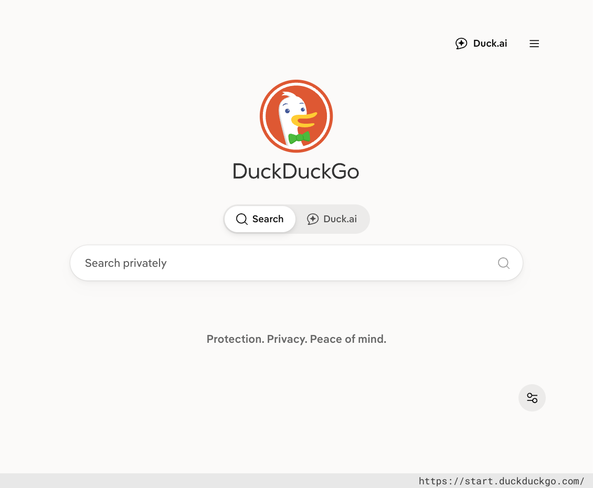

+++
title = "My Browser Has No Tabs: qutebrowser on niri"
date = 2026-11-23
draft = false
description = "Why I use qutebrowser, and why I turned off its tabs and let niri manage every page as a window instead."
tags = ["qutebrowser", "niri", "wayland", "tiling", "browser"]
categories = ["linux"]
+++

My browser is [qutebrowser](https://qutebrowser.org): a keyboard-driven browser
built on QtWebEngine, configured in Python, with a vim-like modal interface.
I've used it for years. The one setting that changed how I use it most is
also the one that sounds the strangest: I don't use its tabs. Every page is a
window, and my compositor manages them.

This post is about why qutebrowser suits me, and what happens when a
browser stops managing its own windows.

<!--more-->

## Why qutebrowser

Most browsers are built around the mouse and offer the keyboard as a shortcut.
qutebrowser is the other way round. It has modes like vim: normal mode for
moving around and running commands, insert mode for typing into a page, and a
command line on `:` for everything else. Every key binding runs a command,
and every command can be typed, bound or chained, so there's no behaviour
that only a menu can reach.

### Built on QtWebEngine

qutebrowser doesn't have its own engine. It's written in Python on top of Qt,
and pages are rendered by QtWebEngine, which is Qt's packaging of Chromium.
qutebrowser itself is the interface around it: the modes, the key bindings,
the command line and the configuration.

In practice, sites render like they do in Chrome, so I rarely have
compatibility problems. The catch is that QtWebEngine follows Qt's release
cycle, not Chromium's, so it's usually a few Chromium versions behind, and
security fixes arrive when Qt ships them.

### Only a status bar

The interface is almost nothing. There's no toolbar, no URL bar, no buttons
and, in my setup, no tab bar either (more on that below). What's left is the
status bar at the bottom. It shows the current mode, the URL, the scroll
position and loading progress, and it turns into the command line when I
press `:` or `o`. The page gets the rest of the window.



### Hints

Hints are how you click without a mouse. Pressing `f` puts a short label of
home-row letters on every link and button on the page. Typing a label follows
that link. The same mechanism does more depending on how it's started:

| Keys | What the selected hint does |
| --- | --- |
| `f` | follow the link |
| `F` | open the link in a new tab |
| `;b` | open it in a background tab |
| `;y` | copy the link's URL |
| `;d` | download the link |
| `;i` | select an image instead of a link |

To type into a form, `gi` focuses the first input field and enters insert
mode; `Esc` gets back to normal mode. Between hints, `j`/`k` to scroll and
`H`/`L` for back and forward, I rarely touch the mouse.

### Quickmarks and search engines

`o` opens the command line with `:open` already typed, and completes over
history, bookmarks and quickmarks. Whatever I type there is either a URL, a
quickmark or a search.

A **quickmark** is a short name for a URL. `o yt` opens YouTube, and
`o syncthing` opens the local Syncthing web UI. Normally you save them with `m`
and they're kept in a plain text file, `name url` per line. Mine are generated
by Nix instead (see below), so the list is the same on every machine.

A **search engine** is a short prefix for a URL with a `{}` placeholder:

```python
c.url.searchengines = {
    "DEFAULT": "https://duckduckgo.com/?q={}",
    "w": "https://en.wikipedia.org/w/index.php?search={}",
    "np": "https://search.nixos.org/packages?query={}",
}
```

`o w qutebrowser` searches Wikipedia, `o np firefox` searches nixpkgs, and
anything that isn't a URL, quickmark or known prefix goes to `DEFAULT`.
Between the two, I almost never type a full URL.

### Adblocking

qutebrowser has a built-in adblocker, enabled by default. It has two
methods:

- **hosts:** blocks whole hostnames from hosts-file lists, like a
  Pi-hole in the browser.
- **adblock:** uses Brave's adblock engine (the `adblock` Python library) and
  understands ABP-style filter lists like EasyList and EasyPrivacy. It can
  block individual URLs, not only whole domains.

The default method, `auto`, uses the adblock engine when the library is
installed and falls back to hosts otherwise. The lists are configured with
`content.blocking.adblock.lists`, and `:adblock-update` downloads them.

The defaults are EasyList and EasyPrivacy. I use uBlock Origin's own lists
instead, plus Peter Lowe's ad server list and URLhaus's malware list:

```python
c.content.blocking.adblock.lists = [
    "https://ublockorigin.github.io/uAssets/filters/filters.txt",
    "https://ublockorigin.github.io/uAssets/filters/badware.txt",
    "https://ublockorigin.github.io/uAssets/filters/privacy.txt",
    "https://ublockorigin.github.io/uAssets/filters/quick-fixes.txt",
    "https://ublockorigin.github.io/uAssets/filters/unbreak.txt",
    "https://pgl.yoyo.org/adservers/serverlist.php?hostformat=adblockplus&showintro=0&mimetype=plaintext",
    "https://malware-filter.gitlab.io/urlhaus-filter/urlhaus-filter-online.txt",
]
```

uBlock Origin's lists are written for uBlock Origin, so qutebrowser doesn't
understand every rule in them. Its engine blocks requests, but doesn't hide
elements on the page (cosmetic filtering) or rewrite scripts, so some empty
boxes stay where ads would have been. The `unbreak` and `quick-fixes` lists
help with the sites that the other lists would otherwise break. For blocking
trackers, ads and malware domains, it's enough for me.

### Configuration as code

The config is a Python file, `config.py`, with every setting available as
`c.<option>`. That makes it easy to generate, which matters for how I manage
it (more on that below).

The usual cost applies: some sites expect a mouse, and it's not the browser
to hand someone who's never used vim.

## Tabs are windows

qutebrowser has one option that turns its tab model off:

```python
c.tabs.tabs_are_windows = True
```

With it set, every new tab is opened as a new top-level window. `:open -t`,
`F` or `;b` on a hint, a link with `target="_blank"`: they all create a
window. The tab bar then only ever has one entry, so I hide it and keep only
the status bar:

```python
c.tabs.show = "never"
```

Everything else stays the same. It's still one qutebrowser process with one
history, one set of quickmarks and one session. The windows just aren't
grouped inside a frame that qutebrowser draws.

### Why I want that

A browser's tab bar is a small window manager. It has its own way to
switch, reorder, move between windows, and split (or not). On a tiling desktop
I already have a window manager, and it's a much better one. I spend time
learning and configuring its keys, so a second, worse set of keys for the
same job, only valid inside one application, is just friction.

When pages are windows:

- **One set of keys for everything.** Moving focus, moving a page to another
  workspace, closing it, making it full width: they're the same bindings I
  use for terminals and everything else.
- **Pages tile next to each other.** Documentation beside the editor, two
  pages side by side for comparison, a video in a corner. A browser that
  manages its own tabs can't put one tab next to a terminal.
- **Workspaces group by task, not by application.** The docs for the thing
  I'm working on live on the same workspace as the terminal I'm working in.
  A different project's pages live with that project. I don't have a
  "browser window" that collects everything.
- **The compositor's switcher sees every page.** Whatever lists or switches
  windows (the overview, a window picker) lists individual pages.

### With niri

I use [niri](https://github.com/YaLTeR/niri), a scrollable-tiling Wayland
compositor. Windows sit in columns on an infinitely wide strip per workspace,
and opening a window never resizes the ones already there. That fits a
browser that opens lots of short-lived pages well: following a few links
just adds columns to the right, and I scroll back when I'm done.

If I ever do want tabs back, niri can handle that too. It can stack several
windows in one column and show the column *tabbed*, with an indicator per
window. The grouping then happens in the compositor, so it works for any
windows, not only browser pages.

### What changes inside qutebrowser

A few qutebrowser features assume tabs and become irrelevant: tab-cycling
keys (`J`/`K`), pinned tabs, and moving tabs within a window. I rebind or
ignore them.

Some still help:

- **`:tab-select`** completes over every open page across all windows and
  focuses the chosen one. It's a page switcher that works no matter where on
  which workspace the window is.
- **Sessions** still save and restore every window.
- **`:tab-give` and `:tab-take`** are less useful, since there's nothing to
  move a single page between.

### Downsides

It isn't free:

- **Lots of windows.** A research session can leave a workspace with a dozen
  columns. I close pages more aggressively than I used to, which is
  probably a good thing.
- **Every window has its own status bar.** That's one line per window that a
  single tabbed window would only pay once. Since the status bar is the only
  interface there is, I don't mind.
- **Sites that open pop-ups** get a full window each, like any other link.
- **It relies on a good window manager.** On a stacking desktop this would be
  much worse than ordinary tabs. The setting only makes sense when the
  compositor is better at managing windows than the browser is.

## How it's configured

My qutebrowser isn't configured in `~/.config`. It's wrapped with
[nix-wrapper-modules](): a NixOS
module generates `config.py` in the Nix store, and the `qutebrowser` on my
`PATH` is pointed at it. Colours and fonts come from the same theme option as
my terminal and launcher, and other modules add their own quickmarks.

## Summary

qutebrowser gives me a browser that works the way the rest of my desktop
does: from the keyboard, through commands, configured as code. Setting
`tabs.tabs_are_windows` takes that further. The browser stops being a
second window manager inside the first one, every page becomes a window like
any other, and niri gets to tile, group, move and switch them with the keys I
already use for everything else.
