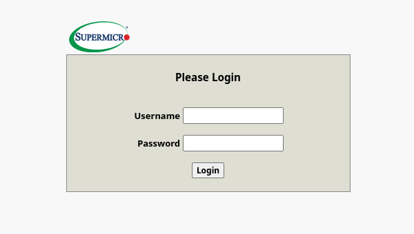
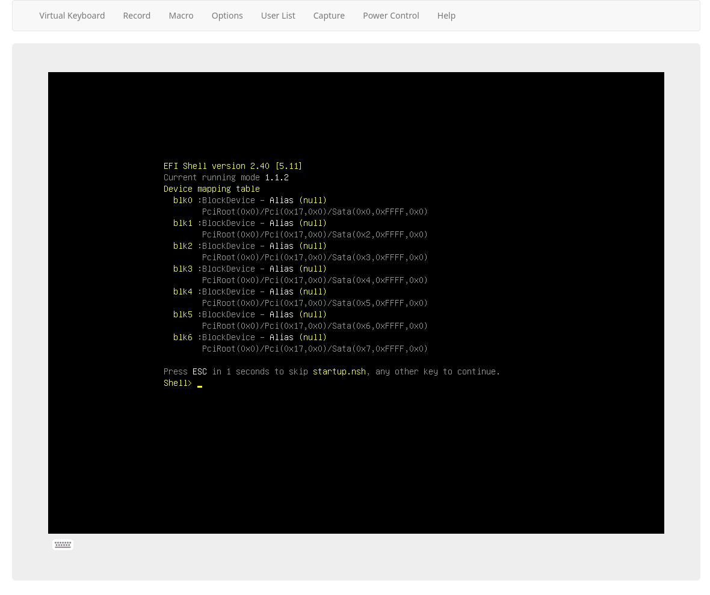

+++
title = 'The BMC Was There All Along: Wiping a NAS via IPMI'
aliases = ['/decommissioning-a-nas-i-could-no-longer-reach/']
date = 2026-11-07
draft = false
description = "Wiping an old TrueNAS box on the wrong subnet with only a VGA port: found over IPv6 link-local, reached through its Supermicro IPMI, and zeroed from the console."
tags = ['truenas', 'ipmi', 'supermicro', 'homelab']
+++

After moving into a new apartment I wanted to wipe my old TrueNAS box and get rid of it. That turned out to be harder than expected. I couldn't SSH into it, and its only video output was VGA, which none of my monitors accept. A VGA → DVI → HDMI adapter chain didn't help either, because VGA is analog and passive adapters only work with analog-capable DVI-I ports.

In the end the board's IPMI got me in. These are the steps that worked.

## 1. Find out why it's unreachable

The old network was `192.168.0.0/24` and the new one is `192.168.1.0/24`. The NAS had a static address (`192.168.0.3`) on the old network, so it was on the wire but on the wrong subnet.

## 2. Join the old subnet

I added a second address on the old subnet to my laptop's ethernet interface and scanned it. Use `sudo` so nmap sends ARP requests, which any machine on the same wire has to answer:

```sh
sudo ip addr add 192.168.0.100/24 dev enp3s0
sudo nmap -sn 192.168.0.0/24
```

The scan found only my laptop.

## 3. Find it over IPv6 link-local instead

Even when the IPv4 configuration is wrong, Linux, BSD and most BMCs still have an IPv6 link-local address. Pinging the all-nodes multicast address lists everything on the segment:

```sh
ping -6 -c3 ff02::1%enp3s0
```

One reply was `fe80::ae1f:6bff:fexx:xxxx`. The `ff:fe` in the middle shows the address was built from a MAC address (EUI-64). Flip one bit in the first byte (`ae` → `ac`) and drop the `ff:fe` to get the MAC `ac:1f:6b:xx:xx:xx`. Its vendor prefix `ac:1f:6b` belongs to **Supermicro**, which fits a server board with VGA only.

```sh
H='fe80::ae1f:6bff:fexx:xxxx%enp3s0'
sudo nmap -6 -p 22,80,443,623 "$H"
```

Ports 22, 80 and 443 were open, and so was **623**, the IPMI port. This was the BMC, a small computer on the motherboard that runs on its own, independent of the host OS.

(`ssh` refused the link-local address until I forced IPv6 with `ssh -6`.)

## 4. Open the IPMI web UI

Browsers don't handle link-local addresses with a zone ID well, so I forwarded a local port with `socat`:

```sh
socat TCP4-LISTEN:8443,fork,reuseaddr 'TCP6:[fe80::ae1f:6bff:fexx:xxxx%enp3s0]:443'
```

At `https://localhost:8443` I logged in as `ADMIN`. The password is on a sticker on the board; older boards use `ADMIN`.



Under **Remote Control → iKVM/HTML5** I had the machine's screen in my browser. That replaced the missing monitor.



## 5. Try to fix the network from the console

The TrueNAS console menu has *Configure network interfaces*. At its prompts, don't delete the interface; just say yes to DHCP. In my case restarting the network failed, so I gave up on the web UI and chose **Shell** instead.

## 6. Wipe the data disks from the shell

TrueNAS CORE runs on FreeBSD, so disks are named `adaX`. First find out which disks belong to the boot pool and leave those alone:

```sh
zpool status
glabel status   # maps gptid/... to adaX
```

`zpool destroy` failed with *pool or dataset is busy* because TrueNAS keeps its system dataset on the data pool. You don't need to destroy it, because overwriting the disks destroys the pool anyway:

```sh
zpool set failmode=continue tank     # don't hang when the pool breaks
sysctl kern.geom.debugflags=16       # allow raw writes to disks that are in use
swapoff -a                           # CORE puts swap partitions on data disks
dd if=/dev/zero of=/dev/ada1 bs=1m & # one per data disk, all in parallel
```

Some practical notes:

- **Console spam.** The dying services flood the console with errors, and your typing still works underneath. `conscontrol mute on` quiets kernel messages. The easiest way out is to switch to another virtual console with **Alt+F2** (and back with **Alt+F1**). Log in there as `root`. If the browser grabs the key combination, send it from the iKVM's virtual keyboard or macro menu.
- **Keyboard layout.** The iKVM sends raw key codes. `kbdcontrol -l ch` (or `us`) makes the console match your physical keyboard.
- **Leaving it overnight.** Closing the iKVM window doesn't end the console session. Just don't `exit` the shell. Running `disown -a` first makes it safer.

Expect roughly disk size ÷ ~150 MB/s per disk, about 7–8 hours for a 4 TB HDD. Since the disks run in parallel, the largest (or slowest) one sets the total time. Each `dd` ends with *No space left on device*, which means it reached the end of the disk.

### Monitoring progress

```sh
ps ax | grep 'dd if'                # which wipes are still running
pkill -INFO dd                      # each dd prints bytes written so far and its rate
gstat                               # live write speed per disk (q to quit)
diskinfo -v ada1 | grep mediasize   # total size of a disk
```

Remaining time ≈ (disk size − bytes written) ÷ rate. Rely on `ps` rather than `jobs`: once you `disown` the jobs, `jobs` no longer lists them.

If one disk is much slower than the others, check its health:

```sh
smartctl -a /dev/ada1 | grep -Ei 'realloc|pending|uncorrect|health'
```

Rising reallocated or pending sector counts mean the disk is failing. In that case, physically destroying it is a better choice than waiting.

To spot-check a finished disk:

```sh
dd if=/dev/ada1 bs=1m count=100 2>/dev/null | hexdump -C | head
```

All zeros (a single line followed by `*`) means the disk is wiped.

## 7. Wipe the boot SSD

You can't reliably wipe the disk the OS is running from. Zeroing an SSD also misses its spare blocks, so the better tool is a discard or secure erase from a live system:

1. Write the **NixOS minimal ISO** to a USB stick and plug it into the NAS.
   (IPMI *Virtual Media* can mount an ISO as well.)
2. Reset the machine from the IPMI and press **F11** at the Supermicro logo to open the boot menu.
3. In the live system:

```sh
sudo -i
lsblk -o NAME,SIZE,FSTYPE,LABEL,MODEL,SERIAL   # boot SSD still shows "boot-pool"
blkdiscard -s /dev/disk/by-id/ata-<model>_<serial> \
  || blkdiscard /dev/disk/by-id/ata-<model>_<serial>
```

Using the `/dev/disk/by-id` path makes sure you don't accidentally wipe the USB stick.

## Takeaways

- **Check for IPMI before you need it.** A Supermicro board's BMC gives you a remote screen, power control and virtual media. Mine had been there all along.
- **IPv6 link-local finds anything** on the wire, however broken its IPv4 setup is.
- **Change the NAS to DHCP before moving**, or at least write down its address.
